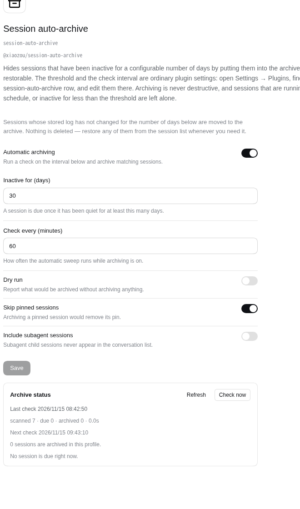

# Session auto-archive

A DeepSeek Harness plugin that archives sessions which have been quiet for
longer than a configurable number of days. Archiving is the same reversible
operation the session list offers: a session disappears from the conversation
list and can be restored at any time. Nothing is deleted, and no session event
or transcript is read.



## Install

The package is published as **`@xiaozou-wine/session-auto-archive`**.

From the Web GUI: **Plugins → Add plugin**, enter
`@xiaozou-wine/session-auto-archive`, then enable the plugin.

From a terminal:

```bash
dsh plugin --profile web add @xiaozou-wine/session-auto-archive
```

The plugin needs DeepSeek Harness `>=0.2.2-rc.1` (it uses the workspace
archive API and the Plugins page's row-configuration slot) and Node.js `>=24.9.0`.

## What it does

- A sweep lists the profile's stored sessions, works out when each session's log
  was last written, and archives the ones that have been idle for at least the
  configured number of days, oldest first.
- A session is never touched when it is already archived, running or otherwise
  active (a turn, a job, a subagent, a scheduled delivery), pinned, or when its
  last activity is inside the window.
- Subagent child sessions are skipped by default: they never appear in the
  conversation list.
- `dryRun` reports what would be archived without writing anything.

The sweep runs shortly after startup and then on the configured interval. Every
value is a live setting: the Settings page writes it through the profile patch
and the running plugin re-reads it on the next check.

## Settings

Open **Settings → Plugins**, find the plugin card, and open the
`session-auto-archive` row. The configure page holds:

| Setting | Default | Meaning |
|---|---|---|
| Automatic archiving | `true` | Run the periodic sweep. The status card and "Check now" keep working when it is off. |
| Inactive for (days) | `30` | A session is due once its stored log has not changed for at least this many days. |
| Check every (minutes) | `60` | How often the automatic sweep runs. |
| Dry run | `false` | Report the matches without archiving them. |
| Skip pinned sessions | `true` | Archiving a pinned session would also drop its pin. |
| Include subagent sessions | `false` | Also archive subagent child sessions. |

The status card below the form shows the last check (scanned, due, archived,
failures), the next scheduled check, the profile's archived total, and the
sessions due right now. **Check now** runs a sweep immediately.

The same values can be edited by hand in the profile's `cordis.patch.yml`; the
patch replaces the whole config, so restate the keys you want to keep:

```yaml
- id: session-auto-archive
  name: '@xiaozou-wine/session-auto-archive'
  config:
    enabled: true
    days: 30
    intervalMinutes: 60
    dryRun: false
    skipPinned: true
    includeSubagentSessions: false
```

## How activity is judged

For the shipped JSONL persistence backend, every accepted event batch is written
straight to the session's compressed log, so the log file's modification time is
an accurate "last activity" that costs one `stat` instead of replaying the log.
The value is floored by the session's creation time, which is also the fallback
for a session without a materialized artifact (an unmaterialized new session, or
another persistence backend).

## Routes

The Host half serves two JSON routes for the settings page:

- `GET /plugin-api/session-auto-archive/status` — the status document;
  `?preview=1` also computes the sessions that are due right now.
- `POST /plugin-api/session-auto-archive/run` — one immediate sweep. It requires
  the `x-session-auto-archive: 1` header and a same-origin request.

## Limits

- A session targeted by an active scheduled task is refused by the workspace
  registry and stays unarchived, by design: the archive would break delivery.
- Archiving a session that is running work is never forced; the sweep leaves it
  for a later check.
- The first sweep archives everything already idle beyond the threshold, capped
  at 200 sessions per sweep; the next sweep continues where it stopped.

## Development

```bash
npm test          # or: node --test
```

The suite covers settings normalization, mtime/creation-time activity, the four
skip families, oldest-first archiving with active/missing/failure outcomes, dry
runs, both routes (including the forbidden and wrong-method cases), live
settings changes through `loader/volatile-update`, and the browser half's slot
registration and field specs. See [docs/DETAIL.md](docs/DETAIL.md) for the
architecture notes ([中文](docs/DETAIL.zh.md)).

## License

MIT
