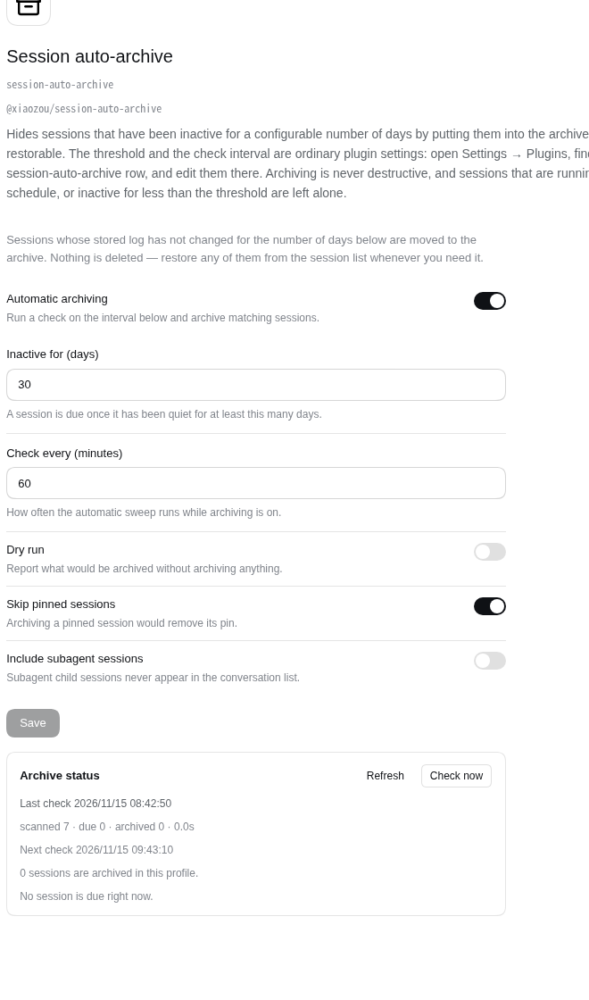

# Session auto-archive — detail



## Files

| Path | Role |
|---|---|
| `index.js` | Host half: settings schema, inactivity scan, archive sweep, status/run routes, timers. |
| `client.js` | Browser half: the settings page registered into the Plugins page's `plugins.row.config` slot for `@xiaozou-wine/session-auto-archive#session-auto-archive`. |
| `cordis.patch.yml` | Bundle layer inserting the `session-auto-archive` row with its defaults. |
| `locale/en.json`, `locale/zh.json` | Plugin card title, description, and the detail link. |
| `test/smoke.test.mjs` | Decision, archive, route, and live-settings tests over a fake context. |

## Host half

`apply(ctx, config)` requires `sessionPersistence` and `workspaceRegistry`. The
settings are read through `readOptions`, which accepts both Cordis volatile
reference fields (`.get()`) and plain configured values, so the plugin keeps
working when the schema is unavailable.

### The scan

`collectDue(ctx, options, now)` calls `ctx.sessionPersistence.list()` once and
walks the snapshots:

1. Skip ids already in `workspaceRegistry.archivedSessionIds`.
2. Skip pinned ids when `skipPinned` is set (`pinnedSessionIds`).
3. Skip `header.origin === 'subagent'` unless `includeSubagentSessions` is set.
4. Resolve the last activity (`lastActivityOf`): the JSONL artifact's
   `mtimeMs`, floored by `header.createdAt`; `createdAt` alone for a snapshot
   without a materialized artifact.
5. Keep the session when that instant is older than `now - days * 86400000`.

The result carries the due sessions (oldest first) plus one counter per skipped
family, which the status document reports.

### The archive

`archiveDue` archives at most 200 sessions per sweep in the plan's order, with
no `stopActivity` option: a session with running work is reported by the
registry as `WorkspaceActiveSessionError` and counted, never forced. A session
that disappeared between listing and archiving arrives as
`WorkspaceUnknownSessionError`. Both are counted; other failures keep their
message in `errors`. When `dryRun` is on, nothing is written.

Sweeps are serialized: a second trigger while one is running shares the
in-flight promise. The sweep yields to the event loop after each archive so a
large batch never blocks the Host.

### Cadence

`apply` arms one timer: the first sweep 20 seconds after load, then one sweep per
`intervalMinutes`. The timer is `unref`'d so it never keeps the process alive.
A `loader/volatile-update` event (the loader's announcement after a settings
write) re-arms the timer from the new values; disabling archiving clears it and
keeps the routes available.

### Routes

`ctx.inject(['webServer'], …)` registers two exact routes that follow the web
server's lifetime:

- `GET|HEAD /plugin-api/session-auto-archive/status` — `plugin`, `version`,
  resolved `config`, `archivedTotal`, `pinnedTotal`, `running`, `lastRun`,
  `lastError`, `nextRunAt`, and with `?preview=1` a `preview` block listing up
  to 50 due sessions with their last-activity time and basis.
- `POST /plugin-api/session-auto-archive/run` — requires the
  `x-session-auto-archive: 1` header and a same-origin request, runs one sweep,
  and answers `{ run, status }`. No CORS headers are sent, so a cross-origin
  request with the header cannot pass its preflight.

## Browser half

`client.js` is a hand-written module-loader bundle: it requires only the
baseline `react` and `@deepseek-ai/dsh-client-ui-primitives` modules and the
`slots`, `locale`, and `configForms` services.

- The page registers into `plugins.row.config` keyed
  `@xiaozou-wine/session-auto-archive#session-auto-archive`, which is how the plugins
  page keys a row's configuration page. Registering it also makes the row's
  configure control appear.
- A `SettingsFormModel` over the `session-auto-archive` settings namespace
  stages the six fields. The number fields use the primitives'
  `settingsNumberField`; the switches use a small local field spec whose
  `format`/`parse` map `on`/`off`, so every switch joins the same staged Save.
- `SettingsForm` provides the Save button, dirty/invalid state, and the
  read-only and unavailable messages; `SettingsValueField` provides the numeric
  inputs with per-field reset.
- The status card subscribes to a small store over the two routes: it loads the
  status and preview when the page opens, reloads after a save, and
  `Check now` posts to the run route.

`whileServed` keeps the registration tied to the Host exposing the namespace, so
a deployment without this plugin's settings shows no page.

## Tests

```bash
cd plugins/session-auto-archive
node --test
```

The suite covers settings normalization, mtime/creation-time activity, the
four skip families, oldest-first archiving with active/missing/failure
outcomes, dry runs, both routes (including the forbidden and wrong-method
cases), and live settings changes through `loader/volatile-update`.
