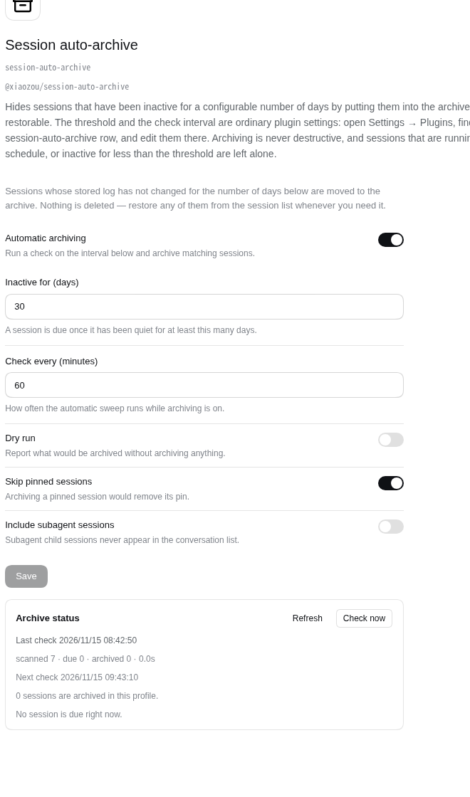

# 会话自动归档 — 细节



## 文件

| 路径 | 作用 |
|---|---|
| `index.js` | Host 半：设置 schema、活动时间扫描、归档扫描、状态/手动路由、定时器。 |
| `client.js` | 浏览器半：设置页面，注册到插件页 `plugins.row.config` 槽位的 `@xiaozou-wine/session-auto-archive#session-auto-archive` 键。 |
| `cordis.patch.yml` | Bundle 层：插入带默认值的 `session-auto-archive` 行。 |
| `locale/en.json`、`locale/zh.json` | 插件卡片标题、说明与细节链接。 |
| `test/smoke.test.mjs` | 基于假 ctx 的判定、归档、路由与实时设置测试。 |

## Host 半

`apply(ctx, config)` 依赖 `sessionPersistence` 与 `workspaceRegistry`。设置由
`readOptions` 读取，既支持 Cordis 的 volatile 引用字段（`.get()`），也支持普通配置
值，因此即使 schema 不可用插件也能工作。

### 扫描

`collectDue(ctx, options, now)` 只调用一次 `ctx.sessionPersistence.list()`，然后逐条处理：

1. 已在 `workspaceRegistry.archivedSessionIds` 中的跳过。
2. `skipPinned` 为真时跳过 `pinnedSessionIds` 中的会话。
3. 除非开启 `includeSubagentSessions`，跳过 `header.origin === 'subagent'` 的会话。
4. 用 `lastActivityOf` 求最后活动时间：JSONL 产物的 `mtimeMs`，并以
   `header.createdAt` 兜底（取两者较大值）；没有实体产物时只用创建时间。
5. 该时间早于 `now - days * 86400000` 的会话进入待归档列表。

结果包含待归档会话（最久未活动的在前）以及每一类被跳过会话的计数。

### 归档

`archiveDue` 按顺序归档最多 200 个会话，且不传 `stopActivity`：有工作正在运行的会话
会被注册表以 `WorkspaceActiveSessionError` 拒绝并计数，绝不强制停止；列表与归档之间
消失的会话得到 `WorkspaceUnknownSessionError`；其他失败把消息写进 `errors`。
`dryRun` 为真时不写入任何内容。多次触发会共享同一个进行中的扫描；每归档一个会话后让出
事件循环，避免大批量阻塞 Host。

### 节奏

`apply` 只维护一个定时器：启动 20 秒后第一次扫描，之后每 `intervalMinutes` 一次；
定时器 `unref`，不会阻止进程退出。设置写入后 loader 发出 `loader/volatile-update`，
插件据此用新值重新定时；关闭自动归档会清除定时器但保留路由。

### 路由

`ctx.inject(['webServer'], …)` 注册两条随 web server 生命周期存在的精确路由：

- `GET|HEAD /plugin-api/session-auto-archive/status`：返回 `plugin`、`version`、
  生效的 `config`、`archivedTotal`、`pinnedTotal`、`running`、`lastRun`、
  `lastError`、`nextRunAt`；带 `?preview=1` 时另附最多 50 条待归档会话及其
  最后活动时间与依据。
- `POST /plugin-api/session-auto-archive/run`：要求 `x-session-auto-archive: 1`
  且同源，立即执行一次扫描，返回 `{ run, status }`。服务不返回任何 CORS 头，
  因此携带该头的跨源请求无法通过预检。

## 浏览器半

`client.js` 是手写的模块加载器 bundle，只依赖基线的 `react`、
`@deepseek-ai/dsh-client-ui-primitives`，以及 `slots`、`locale`、`configForms` 服务。

- 页面注册到 `plugins.row.config`，键为
  `@xiaozou-wine/session-auto-archive#session-auto-archive`：插件页据此为该行显示配置入口。
- 一个针对 `session-auto-archive` 设置命名空间的 `SettingsFormModel` 暂存六个字段。
  数字字段用原语 `settingsNumberField`；开关用一个本地的字段描述，把 `on`/`off`
  映射成布尔值，因此所有开关共用同一个「保存」。
- `SettingsForm` 提供保存按钮、脏/非法状态与只读、不可用提示；`SettingsValueField`
  提供数字输入和逐字段恢复默认。
- 状态卡片订阅一个读取两条路由的小 store：打开页面时读取状态与预览，保存后刷新，
  「立即检查」向运行路由发 POST。

`whileServed` 让注册跟随 Host 是否提供该命名空间：没有本插件设置的环境不会显示页面。

## 测试

```bash
cd plugins/session-auto-archive
node --test
```

覆盖：设置归一化、mtime/创建时间判定、四类跳过、按最久未活动顺序归档及运行中/不存在/
失败结果、试运行、两条路由（含 403 与 405）、以及 `loader/volatile-update` 后的实时设置。
